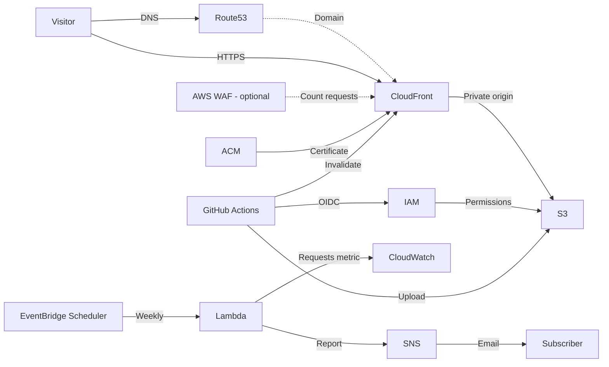

# Portfolio hosting



**Before publishing:** HTML is public. Embed assets or host them separately.
AWS and domain registration charges apply.


## Setup

1. Publish as `KFrost533/infra-s3-portfolio`; protect `main`. Match the owner and repository IDs in `terraform/main/variables.tf`.
2. Copy `terraform.tfvars.example`; set a unique bucket, registered domain, and hosted zone ID in local `terraform/creds/main.json`.
3. Bootstrap the GitHub OIDC provider and portfolio bucket, and set `github_oidc_provider_arn` to the bootstrap output. For an existing bucket, follow the [bucket migration procedure](terraform/bootstrap/README.md#migrating-an-existing-portfolio-bucket) before running main. Do not delete a shared provider.
4. Configure the S3 backend, then run `terraform init` and `terraform validate` in `terraform/main`. Terraform only adds records to the supplied zone.
5. Delegate the domain to that zone; creating a hosted zone does not register a domain.
6. Review the full plan before applying. The former managed zone leaves state but is not deleted. Keep the ACM validation CNAME for renewal.
7. Set GitHub Actions variables and secrets from Terraform outputs.

### Automatic Terraform apply

- Scheduled runs and manual runs from `main` plan and apply the configuration in `terraform/main`, including its `modules` directory.
- Configure repository variable `AWS_REGION` and repository secrets `TF_APPLY_ROLE_ARN`, `AWS_ACCOUNT_ID`, `PORTFOLIO_BUCKET`, `HOSTED_ZONE_ID`, and `TF_STATE_BUCKET`. The state bucket secret must match the backend configured in Terraform.
- The workflows pass `AWS_REGION` and `PORTFOLIO_BUCKET` as Terraform inputs. Other inputs use the defaults in `terraform/main/variables.tf`; ensure they match the values used for the existing infrastructure before running either workflow.
- Grant the role Terraform resource permissions, remote-state S3 access, and `ssm:GetParameter` (plus `kms:Decrypt` for a customer-key-encrypted email parameter).
- Automatic apply blocks plans containing deletions or replacements. Review those changes and use a deliberate manual process.

Bootstrap resources are managed separately from `terraform/main` and must
survive its destruction:

- `terraform/bootstrap` manages the portfolio bucket, its versioning and public access block, the GitHub OIDC provider, and separate apply/destroy roles. Bootstrap it manually with administrative AWS credentials; see [its README](terraform/bootstrap/README.md).
- Create the state bucket `tf-kfrost533` in `ap-southeast-2` beforehand, with versioning, encryption, and public access blocked. Bootstrap stores its state under a separate key in this bucket.
- Keep the Route 53 hosted zone and domain registration outside `terraform/main`; Terraform only manages records in the supplied zone.
- Create the SSM email parameter (default `mail_address`) beforehand if the weekly report is enabled.

For a rebuild, keep the remote state bucket and an accurate state. Do not delete
or manually edit the state object. Resources deleted outside Terraform require
state reconciliation before automatic apply.

Use authorised credentials. Keep variables and state private; use a secure
shared backend. ACM validation may time out before DNS propagation.

### Automatic infrastructure destruction

- **Schedule:** Weekdays 19:00 JST (10:00 UTC), or manually from `main`. GitHub may delay or disable schedules.
- **Protection:** After migration, the portfolio bucket, its objects, versions, versioning and public access block remain under bootstrap management. Main's other infrastructure can be destroyed, and the workflow never empties the bucket. Bootstrap uses `prevent_destroy` for the bucket.
- **Limitations:** Main destroys its CloudFront distribution and bucket policy, including the policy's HTTPS-only restriction; the bucket's public access block remains. `prevent_destroy` applies only while the resource configuration is present and does not prevent deletion through AWS. The workflow also rejects plans that delete the portfolio bucket, state bucket, or GitHub OIDC provider.
- **Failures:** Permissions or dependencies may block deletion. Check failed runs and remaining resources; no alert is configured.

Setup:

1. Create a separate private state bucket outside this state. Enable versioning and encryption, block public access, restrict access, and retain it. Use Terraform 1.16.6; locking uses S3.
2. Back up local state, then migrate from `terraform/main`:

   ```powershell
   terraform init -migrate-state -backend-config="bucket=YOUR_STATE_BUCKET" `
     -backend-config="key=portfolio/terraform.tfstate" `
     -backend-config="region=YOUR_STATE_BUCKET_REGION"
   ```

  Verify `terraform state list` against the backup. Keep state, tfvars, and credentials private.
3. Create a dedicated destroy OIDC role/provider outside this state. Restrict trust to this repository's `main` and `sts.amazonaws.com`. Grant required resource deletion, S3 state/lock, version, and KMS permissions in both regions. Protect role/workflow changes; do not reuse the deploy role. Move any managed OIDC provider to independent state and set `github_oidc_provider_arn`; deletion is blocked otherwise.
4. Set repository variable `AWS_REGION` to the portfolio region. Set repository secrets:
   - `AWS_ACCOUNT_ID`: portfolio AWS account ID.
   - `TF_DESTROY_ROLE_ARN`: independent destroy role ARN.
   - `HOSTED_ZONE_ID`: ID from `terraform/creds/main.json`.
   - `PORTFOLIO_BUCKET`: portfolio bucket name, matching the state.
   - `TF_STATE_BUCKET`: the state bucket configured in the Terraform backend.
5. Verify the state location configured in the workflow and that Terraform defaults match the values used for the original apply. The workflow verifies the state and planned bucket.

- Use one backend, key, and S3 lock for all Terraform operations.
- Cancellation, errors, or concurrent changes can leave partial destruction. Inspect the run and state before retrying.

### Optional AWS WAF

Set `enable_waf = true` to attach a CloudFront Web ACL in `us-east-1` (default: disabled). WAF and metrics may cost extra; see [AWS WAF pricing](https://aws.amazon.com/waf/pricing/).

The common rule group is counted and the Web ACL allows requests; it does not block. Internal terminating rules may stop later group rules. Review `PortfolioCommonRules` in CloudWatch before considering blocking. Sampling/logging are off. Disabling WAF removes it on the next apply. Review the plan's state move for the former root-address Web ACL.

GitHub Actions deployment configuration:

- Repository variable `AWS_REGION`: Terraform output `aws_region`.
- Repository secret `PORTFOLIO_BUCKET`: Terraform output `bucket_name`.
- Repository secret `DEPLOY_ROLE_ARN`: Terraform output `deploy_role_arn`.

Secrets mask exact matching values in Actions logs, but masking is not guaranteed
for transformed values. Review logs and artifacts before publishing them. Values
already committed to the repository or its history remain public; using Secrets
does not remove them.


### Terraform logs

To save local Terraform output, run the logging wrapper instead of invoking
`terraform` directly. From either `terraform/main` or `terraform/bootstrap`,
use PowerShell 7:

```powershell
..\terraform-log.ps1 init
..\terraform-log.ps1 plan
..\terraform-log.ps1 apply
..\terraform-log.ps1 destroy
```

Run `apply` and `destroy` only when intended, after reviewing the plan.
Additional Terraform arguments can follow the command, for example
`..\terraform-log.ps1 plan -input=false`. Each invocation prints its log path
and writes standard output and errors to a separate file under the
Git-ignored `terraform/log` directory. Logs may contain sensitive data; restrict
access. Running `terraform` directly bypasses the wrapper and is not logged
there. GitHub Actions logs are available in the Actions run, not this local
directory.


## Publishing

1. Edit and commit pages under `portfolio/jp` and `portfolio/en` on `main` (max 10 MiB per HTML file).
2. The build applies `portfolio/assets/portfolio.css`, rejects unsupported template syntax, and supports HTML fragments and career includes.
3. Push to `main` or run **Deploy portfolio HTML to S3** manually. It uploads generated HTML, CSS, and a link index.
4. Open `portfolio_url` or `https://your-domain/portfolio/main.html`. The index links to all language pages and their sections.

- **Cache:** Requires one `Project=portfolio` distribution with the configured S3 origin; invalidates `/*` and waits. Account-wide invalidation may incur charges.
- **Removal:** Superseded S3 pages are not deleted automatically.
- **Failure:** Earlier uploads may succeed; the main page uploads last.
- **Rollback:** An authorised principal can restore versions; the deploy role cannot list versions or delete files.
- **Cleanup:** Handle object versions before stack deletion.

CloudFront caching is off. Language directory URLs do not resolve `index.html`; existing sites are not redirected.

## Optional weekly request report

- **Schedule:** Monday 09:00 Japan time; reports the previous seven complete days.
- **Data:** CloudFront `Requests` in `us-east-1`; includes bots, errors, and assets, not unique visitors. Missing data is labelled, not treated as zero.
- **Enable:** Set `enable_request_report = true`; optionally set `request_report_email_parameter_name` (default `mail_address`). The parameter must be in the Terraform AWS region. Grant the Terraform identity `ssm:GetParameter` and, for a customer-key-encrypted `SecureString`, `kms:Decrypt`. Review the plan and confirm the SNS email subscription.
- **Security:** SSM lookup does not keep the value out of Terraform state; protect state/logs. Lambda reads metrics and publishes only to this SNS topic.
- **Operations:** Logs retained 30 days. Retries may duplicate emails; check CloudWatch/Scheduler for failures. No dead-letter queue.
- **Cost:** SNS, Lambda, Scheduler, CloudWatch, and logs may incur charges.

Terraform packages the Lambda source with the `hashicorp/archive` provider.
The function uses the AWS SDK included in the Lambda Python runtime.
