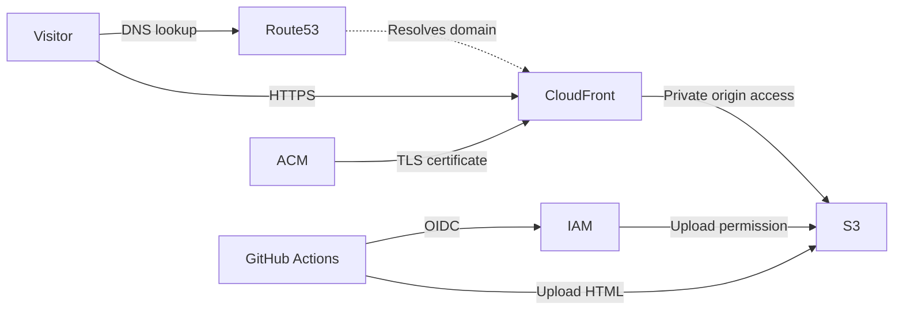

# Portfolio hosting

Publish standalone HTML through private S3 and CloudFront HTTPS.

| Service | Purpose |
|---|---|
| S3 | Private portfolio storage; Sydney by default |
| CloudFront | Public HTTPS and the main page |
| Route 53 | Public hosted zone and DNS records |
| ACM | DNS-validated certificate in `us-east-1` |
| IAM | GitHub Actions deployment via OIDC |

**Review all content before publishing.** Pages are public. Embed assets or
host them separately; the workflow uploads HTML only. AWS and domain
registration charges apply.

## Setup

| Step | Action |
|---|---|
| 1 | Publish this project as `KFrost533/infra-s3-portfolio`. Protect `main` and restrict workflow changes and execution. |
| 2 | Copy `terraform/main/terraform.tfvars.example` to `terraform.tfvars`. Set a globally unique bucket and a domain you control. The portfolio domain must equal the hosted zone or be its subdomain. |
| 3 | Set `github_oidc_provider_arn` if the account already has a GitHub OIDC provider; otherwise Terraform creates one. Coordinate before creating or deleting this account-wide provider. |
| 4 | From `terraform/main`, run `terraform init` and `terraform validate`. Register the domain separately; a hosted zone does not register it. |
| 5 | Review `terraform plan -target=module.route53.aws_route53_zone.portfolio`, then apply that targeted plan only after approval. Use `terraform output hosted_zone_name_servers` to delegate DNS at the registrar or parent zone. Plan migration of existing DNS records first. |
| 6 | After DNS propagation, review the full `terraform plan`, including any replacements or deletions, before applying. ACM validation can time out before delegation propagates; retain its CNAME for renewal. |
| 7 | Set the GitHub Actions variables below from Terraform outputs. |

Use appropriately authorised AWS credentials for provisioning. Do not commit
`terraform.tfvars` or state; use a secure backend for shared state.

| GitHub Actions variable | Terraform output |
|---|---|
| `AWS_REGION` | `aws_region` |
| `PORTFOLIO_BUCKET` | `bucket_name` |
| `AWS_ROLE_ARN` | `deploy_role_arn` |

## Publishing

| Step | Action |
|---|---|
| 1 | Commit reviewed `.html` files under `portfolio/jp` or `portfolio/en` on `main`. Subdirectories are supported; each file must be at most 10 MiB. |
| 2 | Run **Deploy portfolio HTML to S3** manually. It uploads all committed language files to matching paths and generates language links from `portfolio/main.html`. At least one file is required; an empty language is skipped. |
| 3 | Open the `portfolio_url` output or `https://your-domain/portfolio/main.html`. Language directory URLs do not automatically resolve `index.html`. |

| Operation | Behaviour |
|---|---|
| Update | Re-run the workflow after adding or removing files; links reflect the selected commit. Matching S3 objects are overwritten. |
| Remove | Removed repository files remain publicly accessible in S3 until deleted separately by an authorised principal. |
| Failure | Uploads are independent; earlier files may already be updated. The main page uploads last. |
| Cache | CloudFront caching is disabled and browsers are instructed not to cache HTML. Retry briefly cached errors after upload. |
| Rollback | An authorised principal can restore an earlier S3 object version. The deployment role cannot list versions or delete files. |
| Cleanup | Handle stored object versions before deleting the stack. Do not delete a shared OIDC provider. |

Existing websites are not redirected automatically; update their links after
reviewing the published pages.
