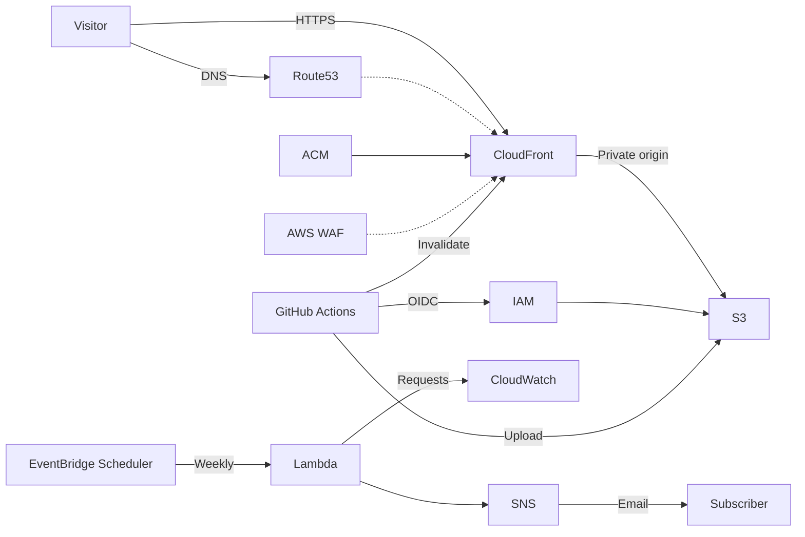

# Portfolio hosting

[日本語](README_jp.md)

Hosts a bilingual portfolio on S3 and CloudFront, with GitHub Actions deployment and Terraform automation.



**HTML is public.** Embed assets or host them separately. AWS and domain registration may incur charges.

## Setup

1. Protect `main` and verify the repository and owner IDs in `terraform/main/variables.tf`. Use a registered domain delegated to an existing Route 53 hosted zone.
2. Create the private S3 state bucket outside Terraform with versioning, encryption and public access blocked. Keep its state and credentials private.
3. Configure and apply [`terraform/bootstrap`](terraform/bootstrap/README.md) with administrative AWS credentials. It manages the portfolio bucket, GitHub OIDC provider and separate apply/destroy roles. For an existing bucket, follow the [migration procedure](terraform/bootstrap/README.md#migrating-an-existing-portfolio-bucket) first.
4. Configure `terraform/main/terraform.tfvars` from `terraform/main/terraform.tfvars.example` and set `hosted_zone_id` in `terraform/creds/main.json`. Set `github_oidc_provider_arn` to the bootstrap output.
5. In `terraform/main`, configure the S3 backend, run `terraform init` and `terraform validate`, and review the full plan before applying. Retain the ACM validation CNAME for renewal.
6. Configure the repository Secrets below. Workflow inputs must match the existing infrastructure and Terraform defaults.

| Secret | Value |
| --- | --- |
| `AWS_REGION` | Portfolio AWS region |
| `AWS_ACCOUNT_ID` | AWS account ID |
| `PORTFOLIO_BUCKET` | Portfolio bucket name |
| `HOSTED_ZONE_ID` | Existing Route 53 hosted zone ID |
| `TF_STATE_BUCKET` | Terraform backend bucket name |
| `TF_APPLY_ROLE_ARN` | Bootstrap apply role ARN |
| `TF_DESTROY_ROLE_ARN` | Bootstrap destroy role ARN |
| `DEPLOY_ROLE_ARN` | Main stack deployment role ARN |

Use the same backend, key and S3 lock for all Terraform operations. Do not edit or delete the state object; reconcile resources changed outside Terraform before applying. Secrets mask matching log values, but transformed values may leak, and committed values remain public in Git history.

## Automation

| Workflow | Schedule (JST, weekdays) | Behavior |
| --- | --- | --- |
| Terraform apply | 09:00 | Plans and applies; blocks deletions and replacements. |
| Portfolio upload | 09:20 | Builds and uploads the site, then invalidates CloudFront. |
| Terraform destroy | 19:00 | Destroys main-stack resources. |

Workflows can also be run manually from `main`; GitHub schedules may be delayed or disabled. Review permissions and plans before enabling automation.

After bucket migration, destroy keeps the bootstrap-managed bucket, objects, versions, versioning and public access block. It removes the CloudFront distribution and main-managed bucket policy, including its HTTPS-only restriction. Bootstrap's `prevent_destroy` applies only while its resource configuration exists and cannot prevent deletion through AWS. Failed or cancelled operations may leave partial changes; inspect state before retrying.

## Publishing

1. Edit and commit pages in `portfolio/jp` and `portfolio/en` (maximum 10 MiB per HTML file).
2. Push to `main` or run **Deploy portfolio HTML to S3**. The build applies `portfolio/assets/portfolio.css` and uploads generated HTML, CSS and an index.
3. Open `portfolio_url` or `https://your-domain/portfolio/main.html`.

The upload requires one `Project=portfolio` CloudFront distribution with the configured S3 origin. Old pages are not deleted automatically; an authorised principal can restore object versions. Failed uploads may be partial. Language directory URLs do not resolve `index.html`.

## Optional features

- **WAF:** `enable_waf` controls the CloudFront Web ACL in `us-east-1` (currently enabled by default). Its managed rule group counts requests rather than blocking them; WAF and metrics may incur [charges](https://aws.amazon.com/waf/pricing/).
- **Weekly report:** Set `enable_request_report = true` and create the SSM email parameter (`mail_address` by default) in the Terraform region. Grant `ssm:GetParameter` and, for a customer-key-encrypted `SecureString`, `kms:Decrypt`; confirm the SNS subscription. Monday 09:00 JST reports the previous seven complete days of CloudFront requests, including bots and errors. The email may appear in Terraform state; protect state and logs. Retries may duplicate emails; there is no dead-letter queue.

## Local Terraform logs

From `terraform/main` or `terraform/bootstrap`, use PowerShell 7:

```powershell
..\terraform-log.ps1 init
..\terraform-log.ps1 plan
..\terraform-log.ps1 apply
..\terraform-log.ps1 destroy
```

Review the plan before apply or destroy. The wrapper writes separate logs to Git-ignored `terraform/log`; direct `terraform` commands do not. 
GitHub Actions logs are available in the workflow run.
