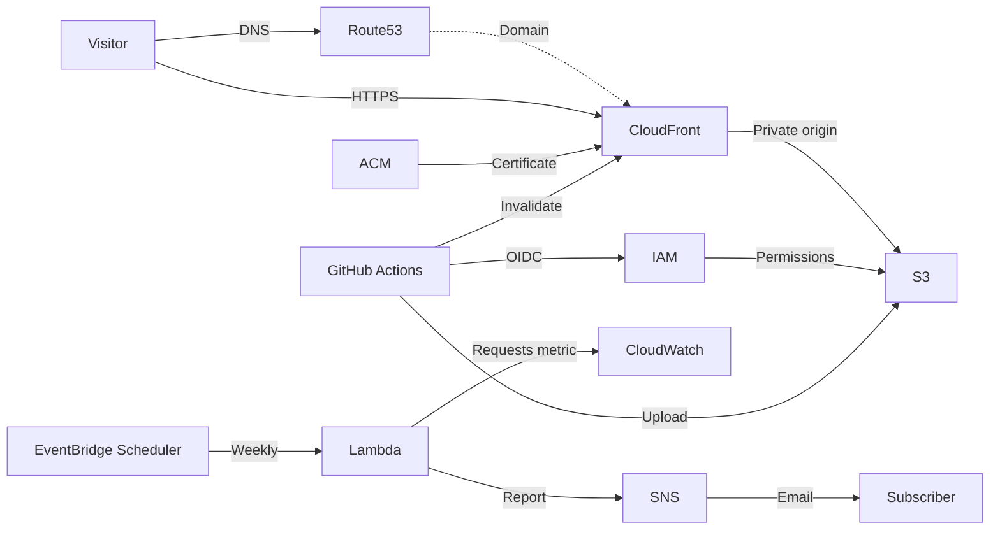

# Portfolio hosting



**Review content before publishing:** HTML becomes public. Embed assets or
host them separately. AWS and domain registration charges apply.


## Setup

| Step | Action |
|---|---|
| 1 | Publish as `KFrost533/infra-s3-portfolio`; protect `main` and restrict workflow access. Keep the GitHub owner and repository IDs in `terraform/main/variables.tf` aligned with this repository. |
| 2 | Copy `terraform/main/terraform.tfvars.example` to `terraform.tfvars`. Set a unique bucket and registered domain. Set the hosted zone ID in the local `terraform/creds/main.json` configuration. |
| 3 | Set `github_oidc_provider_arn` if the account already has one; otherwise Terraform creates it. Do not delete a shared provider. |
| 4 | From `terraform/main`, run `terraform init` and `terraform validate`. Terraform adds records to the supplied hosted zone; it does not create or delete hosted zones. |
| 5 | Ensure the domain registration delegates to that hosted zone. Route 53 does not register the domain when only a hosted zone is created. |
| 6 | Review the full `terraform plan`, including record replacements, before applying. The former Terraform-managed zone is removed from state without being deleted; remove any unused zone manually only after confirming it is no longer needed. Keep the ACM validation CNAME for renewal. |
| 7 | Set the GitHub Actions variables below from Terraform outputs. |

Use authorised AWS credentials. Keep variable files and state private; use a
secure backend for shared state. ACM validation can time out before DNS
delegation propagates.

| GitHub Actions variable | Terraform output |
|---|---|
| `AWS_REGION` | `aws_region` |
| `PORTFOLIO_BUCKET` | `bucket_name` |
| `AWS_ROLE_ARN` | `deploy_role_arn` |


### Terraform logs

From `terraform/main`, use PowerShell 7 to log a command:

```powershell
..\terraform-log.ps1 plan
```

Replace `plan` with `init`, `apply`, `destroy` or another Terraform command.
Logs are in `terraform/log`, which Git ignores. They may contain sensitive
data; restrict access. Direct Terraform commands are not logged.


## Publishing

| Step | Action |
|---|---|
| 1 | Edit and commit the career, skills, and projects pages under `portfolio/jp` and `portfolio/en` on `main`. Each HTML file is limited to 10 MiB. |
| 2 | The build applies `portfolio/assets/portfolio.css` and rejects unsupported template syntax. It also supports HTML fragments and career experience includes when the corresponding text files are provided. |
| 3 | A portfolio change pushed to `main` deploys automatically; **Deploy portfolio HTML to S3** can also run manually. The workflow uploads generated HTML, the shared stylesheet, and a link index. |
| 4 | Open the `portfolio_url` output or `https://your-domain/portfolio/main.html`. The index links to the three pages in each language; each page links to the other sections and its translated counterpart. |

| Operation | Behaviour |
|---|---|
| Cache | The workflow requires exactly one distribution tagged `Project=portfolio` with the configured S3 origin. After upload, it invalidates `/*` and waits. The role has account-wide invalidation access; excess invalidations may incur charges. |
| Removal | Superseded pages removed from Git remain accessible in S3 until deleted separately; the deployment does not delete them. |
| Failure | Earlier uploads may succeed; the main page uploads last. |
| Rollback | An authorised principal can restore an S3 version; the deployment role cannot list versions or delete files. |
| Cleanup | Handle stored object versions before deleting the stack. |

CloudFront caching is disabled. Language directory URLs do not resolve
`index.html` automatically; existing websites are not redirected.

## Optional weekly request report

| Item | Details |
|---|---|
| Schedule | Monday 09:00 Japan time; previous seven complete Japan-time days. |
| Data | CloudFront `Requests` from CloudWatch in `us-east-1`; includes bots, errors and assets, not unique visitors. Missing metric data is labelled, not counted as zero. |
| Enable | Set `enable_request_report = true` and `request_report_email` in an uncommitted `terraform.tfvars`; review the plan before applying. Confirm the SNS subscription email. |
| Security | The email address is stored in Terraform state despite being marked sensitive. Protect state and logs. Lambda can read CloudWatch metrics and publish only to this SNS topic. |
| Operations | Lambda logs are retained for 30 days. Scheduler and Lambda retries can result in duplicate emails; inspect CloudWatch logs and Scheduler metrics for failures. No dead-letter queue is configured. |
| Cost | SNS, Lambda, Scheduler, CloudWatch and log storage may incur charges. |

Terraform packages the Lambda source with the `hashicorp/archive` provider.
The function uses the AWS SDK included in the Lambda Python runtime.
