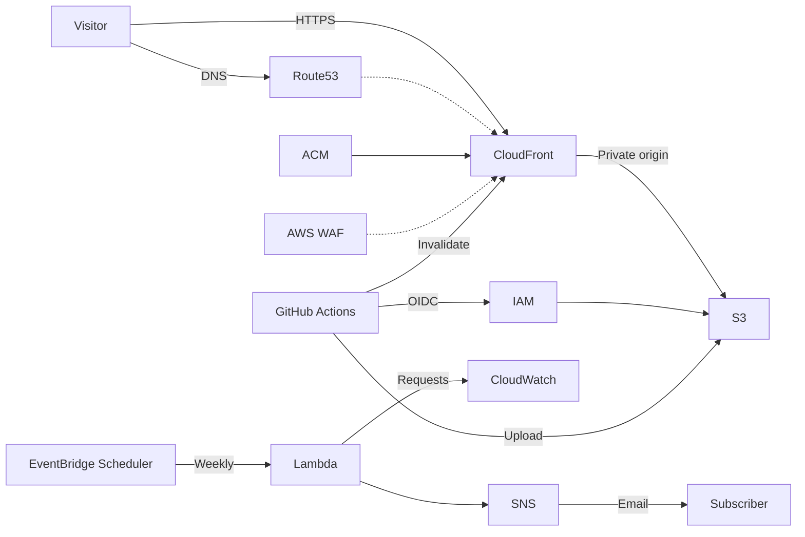

# ポートフォリオのホスティング

[English](README.md)

S3 と CloudFront で日英のポートフォリオを公開し、GitHub Actions と Terraform でデプロイ・インフラ操作を自動化します。



**HTML は公開されます。** アセットは埋め込むか別途ホストしてください。AWS とドメイン登録には料金がかかる場合があります。

## セットアップ

1. `main` を保護し、`terraform/main/variables.tf` のリポジトリ ID とオーナー ID を確認します。既存の Route 53 ホストゾーンに委任した登録済みドメインを使用します。
2. Terraform の管理外に非公開の state 用 S3 バケットを作成し、バージョニング、暗号化、パブリックアクセスブロックを有効にします。state と認証情報は非公開に保ちます。
3. 管理者権限の AWS 認証情報で [`terraform/bootstrap`](terraform/bootstrap/README.md) を設定・apply します。ポートフォリオ用バケット、GitHub OIDC プロバイダー、別々の apply・destroy 用ロールを管理します。既存バケットがある場合は、先に[移行手順](terraform/bootstrap/README.md#migrating-an-existing-portfolio-bucket)に従ってください。
4. `terraform/main/terraform.tfvars.example` をもとに `terraform/main/terraform.tfvars` を設定し、`terraform/creds/main.json` に `hosted_zone_id` を設定します。`github_oidc_provider_arn` には bootstrap の出力を設定します。
5. `terraform/main` の S3 バックエンドを設定し、`terraform init` と `terraform validate` を実行します。apply 前に plan 全体を確認し、更新用の ACM 検証 CNAME を保持します。
6. 以下のリポジトリ Secrets を設定します。ワークフローの入力値と Terraform のデフォルト値を、既存インフラに合わせてください。

| Secret | 値 |
| --- | --- |
| `AWS_REGION` | ポートフォリオの AWS リージョン |
| `AWS_ACCOUNT_ID` | AWS アカウント ID |
| `PORTFOLIO_BUCKET` | ポートフォリオ用バケット名 |
| `HOSTED_ZONE_ID` | 既存の Route 53 ホストゾーン ID |
| `TF_STATE_BUCKET` | Terraform バックエンドのバケット名 |
| `TF_APPLY_ROLE_ARN` | bootstrap の apply ロール ARN |
| `TF_DESTROY_ROLE_ARN` | bootstrap の destroy ロール ARN |
| `DEPLOY_ROLE_ARN` | main スタックのデプロイ用ロール ARN |

すべての Terraform 操作で同じバックエンド、キー、S3 ロックを使用してください。state オブジェクトを編集・削除せず、Terraform の外で変更したリソースは apply 前に state と照合してください。Secrets と一致する値はログでマスクされますが、加工された値は漏れる場合があり、Git 履歴にコミット済みの値も公開されたままです。

## 自動化

| ワークフロー | スケジュール（平日 JST） | 動作 |
| --- | --- | --- |
| Terraform apply | 09:00 | plan・apply。削除と置換を含む変更はブロック。 |
| ポートフォリオのアップロード | 09:20 | サイトをビルド・アップロードし、CloudFront を無効化。 |
| Terraform destroy | 19:00 | main スタックのリソースを削除。 |

各ワークフローは `main` から手動実行もできます。GitHub の定期実行は遅延・無効化される場合があります。自動化を有効にする前に権限と plan を確認してください。

バケット移行後、destroy しても bootstrap 管理のバケット、オブジェクト、バージョン、バージョニング設定、パブリックアクセスブロックは残ります。一方、CloudFront と main 管理のバケットポリシー（HTTPS のみを許可する制限を含む）は削除されます。bootstrap の `prevent_destroy` はリソース構成が存在する間だけ有効で、AWS からの直接削除は防げません。失敗やキャンセルによって変更が一部だけ実行された場合は、再試行前に state を確認してください。

## 公開

1. `portfolio/jp` と `portfolio/en` のページを編集・コミットします（HTML ファイルごとに最大 10 MiB）。
2. `main` に push するか、**Deploy portfolio HTML to S3** を手動実行します。ビルドは `portfolio/assets/portfolio.css` を適用し、生成した HTML、CSS、一覧をアップロードします。
3. `portfolio_url` または `https://your-domain/portfolio/main.html` を開きます。

アップロードには、設定した S3 オリジンを持つ `Project=portfolio` の CloudFront ディストリビューションが1つ必要です。古いページは自動削除されず、権限のあるプリンシパルがオブジェクトのバージョンを復元できます。失敗時は一部だけアップロードされる場合があります。言語ディレクトリの URL は `index.html` に解決されません。

## オプション機能

- **WAF:** `enable_waf` で `us-east-1` の CloudFront Web ACL を制御します（現在のデフォルトは有効）。マネージドルールグループはリクエストをカウントしますが、ブロックはしません。WAF とメトリクスには[料金](https://aws.amazon.com/waf/pricing/)がかかる場合があります。
- **週次レポート:** `enable_request_report = true` を設定し、Terraform のリージョンにメールアドレス用の SSM パラメーター（デフォルト `mail_address`）を作成します。`ssm:GetParameter`、カスタマー管理キーで暗号化した `SecureString` の場合は `kms:Decrypt` を付与し、SNS サブスクリプションを承認してください。月曜 09:00 JST に、ボットやエラーを含む直前の完了した7日間の CloudFront リクエストを報告します。メールアドレスは Terraform state に保存され得るため、state とログを保護してください。再試行によるメール重複の可能性があり、デッドレターキューはありません。

## ローカルの Terraform ログ

`terraform/main` または `terraform/bootstrap` から PowerShell 7 で実行します。

```powershell
..\terraform-log.ps1 init
..\terraform-log.ps1 plan
..\terraform-log.ps1 apply
..\terraform-log.ps1 destroy
```

apply・destroy 前に plan を確認してください。ラッパーは Git 管理外の `terraform/log` にログを出力します。
`terraform` の直接実行は記録されません。

GitHub Actions のログは実行画面で確認できます。
